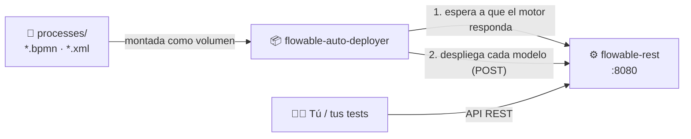

# 🌊 Testing Flowable Engine

> Un motor de procesos **Flowable** listo para pruebas en un solo comando.
> Deja tus modelos BPMN en una carpeta, levanta los contenedores y empieza a lanzar procesos. 🚀


---

## ✨ ¿Qué es esto?

Este proyecto es un componente útil en un **entorno de pruebas** para sistemas de gestión de procesos de negocio (BPM). Con un único `docker compose up` obtienes:

| | Componente | Qué hace |
|---|---|---|
| ⚙️ | **`flowable-rest`** | El motor Flowable, expuesto mediante su API REST en el puerto `8080`. |
| 📦 | **`flowable-auto-deployer`** | Un pequeño contenedor que espera a que el motor esté listo y **despliega automáticamente** todos los procesos de la carpeta [`processes/`](processes/). |

Olvídate de subir los modelos a mano: **lo que pongas en `processes/` estará desplegado en el motor al arrancar**.



> 🐳 El motor usa la imagen oficial [**`flowable/flowable-rest`**](https://hub.docker.com/r/flowable/flowable-rest) de Docker Hub. Allí están las variables de entorno y las opciones de configuración disponibles, por si necesitas cambiar algo: base de datos, credenciales, puertos, etc.

---

## 📋 Requisitos

- [Docker](https://docs.docker.com/get-docker/) con **Docker Compose v2** (incluido en Docker Desktop).
- El puerto **8080** libre en tu máquina.

Nada más. No necesitas Java, ni Maven, ni instalar Flowable. ✅

---

## 🚀 Puesta en marcha en 3 pasos

### 1️⃣ Añade tus procesos

Copia tus modelos BPMN 2.0 en la carpeta `processes/`. Se admiten las extensiones **`.bpmn`** y **`.xml`**.

```
TestingFlowableEngine/
├── docker-compose.yaml
├── README.md
└── processes/
    ├── mockprocess.bpmn      ← incluido de ejemplo
    └── mi-proceso.bpmn       ← ¡añade aquí los tuyos!
```

### 2️⃣ Arranca el entorno

```bash
docker compose up
```

Verás en la consola cómo el desplegador espera al motor y después sube los procesos:

```
flowable-auto-deployer  | Esperando a que el motor Flowable esté iniciado y listo...
flowable-auto-deployer  | Motor aún no disponible, reintentando en 3 segundos...
flowable-auto-deployer  | ¡Motor Flowable listo! Iniciando autodespliegue de modelos BPMN...
flowable-auto-deployer  | Desplegando: /processes/mockprocess.bpmn
flowable-auto-deployer  | Autodespliegue completado con éxito.
```

> 💡 Si prefieres dejarlo en segundo plano, usa `docker compose up -d` y consulta los logs con `docker compose logs -f`.

### 3️⃣ ¡A probar!

El motor queda disponible en:

| | |
|---|---|
| 🌐 **URL base de la API** | `http://localhost:8080/flowable-rest/service` |
| 🧭 **Interfaz Swagger** | <http://localhost:8080/flowable-rest/docs/> |
| 👤 **Usuario** | `admin` |
| 🔑 **Contraseña** | `test` |

Comprueba que todo funciona:

```bash
curl -u admin:test http://localhost:8080/flowable-rest/service/repository/process-definitions
```

---

## 🧭 Explora la API con Swagger

Mientras el motor está arrancado, puedes usar la **interfaz Swagger** en el navegador. Muestra todos los endpoints de la API REST y permite **ejecutarlos directamente**, viendo la petición y la respuesta completas. Es la forma más cómoda de depurar tus procesos. 🐞

👉 **<http://localhost:8080/flowable-rest/docs/>**

**Cómo usarla:**

1. Abre la URL en el navegador.
2. Pulsa **Authorize** 🔓 e introduce el usuario `admin` y la contraseña `test`.
3. Despliega cualquier endpoint, pulsa **Try it out**, rellena los parámetros y ejecuta con **Execute**.

**Especificaciones disponibles:** por defecto se carga la API de procesos (BPMN). Para ver otra, escribe su ruta en la caja de texto de la cabecera y pulsa **Explore**:

| API | Ruta de la especificación |
|---|---|
| ⚙️ Procesos (BPMN) — *por defecto* | `specfile/process/flowable-swagger-process.json` |
| 📂 Casos (CMMN) | `specfile/cmmn/flowable-swagger-cmmn.json` |
| 👥 Usuarios y grupos (IDM) | `specfile/idm/flowable-swagger-idm.json` |
| 📨 Registro de eventos | `specfile/eventregistry/flowable-swagger-eventregistry.json` |
| 📦 Aplicaciones | `specfile/app/flowable-swagger-app.json` |

> 💡 **Ideas para depurar:**
> - `GET /repository/process-definitions` comprueba que tu proceso se ha desplegado y en qué versión está.
> - `GET /runtime/process-instances/{id}/diagram` devuelve la imagen del proceso con la actividad actual resaltada. Solo funciona si el BPMN incluye la información gráfica del diagrama.
> - `GET /runtime/executions?processInstanceId=…` muestra dónde está detenida una instancia.
> - `GET /runtime/process-instances/{id}/variables` muestra las variables de una instancia.
> - `GET /history/historic-activity-instances?processInstanceId=…` muestra el recorrido completo que ha seguido una instancia.

---

## 🧪 Recetario de la API REST

Algunas llamadas habituales para probar tus procesos. Sustituye `mockprocess` por la *key* (el `id` del `<process>`) de tu propio modelo.

> 🪟 **Usuarios de Windows:** en PowerShell, escribe `curl.exe` en lugar de `curl` para usar el curl real y no el alias de PowerShell.

**📜 Listar las definiciones de proceso desplegadas**
```bash
curl -u admin:test http://localhost:8080/flowable-rest/service/repository/process-definitions
```

**▶️ Iniciar una instancia de proceso**
```bash
curl -u admin:test -H "Content-Type: application/json" \
     -d '{"processDefinitionKey": "mockprocess"}' \
     http://localhost:8080/flowable-rest/service/runtime/process-instances
```

**📝 Ver las tareas pendientes**
```bash
curl -u admin:test http://localhost:8080/flowable-rest/service/runtime/tasks
```

**✅ Completar una tarea**
```bash
curl -u admin:test -H "Content-Type: application/json" \
     -d '{"action": "complete"}' \
     http://localhost:8080/flowable-rest/service/runtime/tasks/<ID_DE_LA_TAREA>
```

**🔍 Consultar el estado del motor**
```bash
curl -u admin:test http://localhost:8080/flowable-rest/service/management/engine
```

📚 Referencia completa: [documentación de la API REST de Flowable](https://www.flowable.com/open-source/docs/bpmn/ch14-REST).

---

## 🔎 Trazas de los procesos

Flowable escribe sus trazas con el sistema de logging estándar (**SLF4J + Logback**). Los procesos pueden escribir en ese mismo log **sin desplegar clases Java propias**: basta un *execution listener* de tipo `script` en Groovy, que viene incluido en la imagen.

```xml
<flowable:executionListener event="start" type="script">
  <flowable:script language="groovy"><![CDATA[
org.slf4j.LoggerFactory.getLogger("flowable.process.trace").info(
  "[{}] Mensaje de traza (processInstanceId={})",
  execution.getProcessDefinitionId(), execution.getProcessInstanceId())
]]></flowable:script>
</flowable:executionListener>
```

- Usa `event="start"` o `event="end"` para trazar la entrada o la salida de cualquier evento, tarea o pasarela.
- Dentro del script tienes disponible `execution`, con métodos como `getProcessInstanceId()`, `getCurrentActivityId()` o `getVariable("nombre")`.

Para ver solo las trazas de tus procesos:

```bash
docker compose logs -f flowable-rest | grep flowable.process.trace
```

```
INFO ... flowable.process.trace : [mockprocess:1:…] Inicio el proceso mock (processInstanceId=…, iniciador=admin)
INFO ... flowable.process.trace : [mockprocess:1:…] Inicio de la tarea humana mock 'MockHT' (…)
INFO ... flowable.process.trace : [mockprocess:1:…] Fin de la tarea humana mock 'MockHT' (…)
```

> 💡 Para ver además el detalle interno del motor, añade la variable de entorno `LOGGING_LEVEL_ORG_FLOWABLE=DEBUG` al servicio `flowable-rest` en `docker-compose.yaml`. Genera muchas trazas.

---

## 🔄 Flujo de trabajo habitual

| Quiero… | Comando |
|---|---|
| ▶️ Arrancar todo | `docker compose up -d` |
| 📄 Ver los logs | `docker compose logs -f` |
| ♻️ Volver a desplegar los procesos (tras añadir o modificar alguno) | `docker compose up flowable-auto-deployer` |
| 🧹 Empezar de cero con un motor limpio | `docker compose down && docker compose up -d` |
| ⏹️ Parar todo | `docker compose down` |

> ⚠️ **Ten en cuenta:**
> - El motor usa una **base de datos en memoria**: al eliminar el contenedor (`docker compose down`) se pierden despliegues, instancias e historial. Ideal para pruebas reproducibles. 🧼
> - Si vuelves a lanzar el desplegador sin reiniciar el motor, cada modelo se despliega de nuevo y Flowable crea una **nueva versión** de la definición. Las nuevas instancias usarán siempre la última versión.

---

## 🛠️ Personalización

Todo se configura en [`docker-compose.yaml`](docker-compose.yaml):

- **Credenciales** → variables `FLOWABLE_REST_APP_ADMIN_USER-ID` y `FLOWABLE_REST_APP_ADMIN_PASSWORD`. Si las cambias, actualiza también el `admin:test` que usa el desplegador en sus llamadas `curl`.
- **Puerto** → cambia `"8080:8080"` por, p. ej., `"9090:8080"` para exponer el motor en `localhost:9090`.

---

## 🩺 Solución de problemas

<details>
<summary><b>El puerto 8080 ya está en uso</b></summary>

Otro servicio ocupa ese puerto. Cambia el mapeo en `docker-compose.yaml` (ver *Personalización*) o detén el otro servicio.
</details>

<details>
<summary><b>Mi proceso no aparece desplegado</b></summary>

- Comprueba que el fichero termina en `.bpmn` o `.xml` y está directamente en `processes/` (no en subcarpetas).
- Revisa la respuesta del motor en los logs: `docker compose logs flowable-auto-deployer`. Si el BPMN tiene errores, Flowable devolverá un mensaje explicando el problema.
- Asegúrate de que el proceso está marcado como ejecutable: `isExecutable="true"`.
</details>

<details>
<summary><b>El desplegador se queda esperando indefinidamente</b></summary>

El motor no ha llegado a arrancar. Revisa sus logs con `docker compose logs flowable-rest`.
</details>

<details>
<summary><b>Al iniciar un proceso obtengo un error de expresión</b></summary>

Si tu modelo usa expresiones que llaman a *beans* propios (por ejemplo `${miBean.metodo(execution)}`), esos beans no existen en la imagen estándar de `flowable-rest`. El despliegue funcionará, pero la ejecución fallará al evaluar la expresión. Si solo servían para escribir trazas, sustitúyelos por *listeners* Groovy como los de la sección [🔎 Trazas de los procesos](#-trazas-de-los-procesos).
</details>

---

<p align="center">Para entornos entornos de test únicamente</p>
